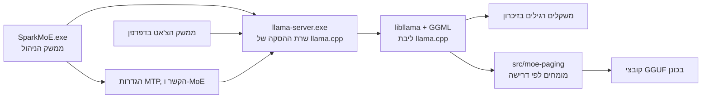

# מפת הפרויקט SparkMoE

עדכון בסיס llama.cpp ותחזוקה בטוחה מתועדים ב־[UPDATING_LLAMA_CPP.md](UPDATING_LLAMA_CPP.md).
רשימת נקודות החיבור והשלבים המעודכנים נמצאת ב־[UPSTREAM_INTEGRATION.md](UPSTREAM_INTEGRATION.md),
והבדיקה האוטומטית שלהן משתמשת ב־`config/upstream-integration.json`.

המסמך הזה מיועד גם למי שאינו מכיר C או C++ ואינו מכיר את מבנה llama.cpp. אין צורך להבין את אלפי הקבצים כדי לתחזק את SparkMoE.

## תשובה קצרה: מהו הפרויקט?

SparkMoE הוא fork מלא של llama.cpp ולא תוכנה קטנה שמותקנת לידו.

כלומר:

- רוב המאגר הוא קוד המקור המקורי של llama.cpp.
- SparkMoE מוסיף מנגנון טעינת מומחי MoE לפי דרישה מהכונן, ממשק ניהול, הגדרות MTP והקשר, כלי בדיקה, אריזה ומתקין.
- `llama-server`, ממשק הצ'אט, תמיכת GGUF, ארכיטקטורות המודלים, sampling, GPU backends וכלי ההמרה מגיעים בעיקר מ-llama.cpp.
- SparkMoE משנה מספר נקודות חיבור בתוך llama.cpp כדי שהמנגנון החדש ישתלב בטעינת המודל, בבניית גרף החישוב ובשרת.
- הפרויקט מכיל את תכונות llama.cpp שהיו קיימות בגרסת upstream שעליה הוא מבוסס. הוא אינו מקבל אוטומטית תכונות שנוספו ל-upstream לאחר אותה נקודה.

## התמונה הגדולה



בעת הפעלה רגילה:

1. המשתמש מפעיל `SparkMoE.exe`.
2. מנהל SparkMoE מציג dashboard מקומי ב-`127.0.0.1:18080`.
3. המשתמש בוחר מודל והגדרות.
4. המנהל מפעיל את `llama-server.exe` שנמצא לידו.
5. `llama-server` טוען את המודל באמצעות ליבת llama.cpp.
6. כאשר מופעל MoE paging, המשקלים הרגילים נטענים בדרך הרגילה, אבל משקלי המומחים המנותבים נקראים מה-GGUF לתוך מטמון מוגבל.
7. ממשק הצ'אט המובנה מדבר ישירות עם `llama-server` דרך API תואם OpenAI.

## שלוש שכבות שחשוב להבדיל ביניהן

| שכבה | מה היא עושה | מקור | רישיון |
| --- | --- | --- | --- |
| ליבת llama.cpp | טעינת GGUF, מודלים, CPU/GPU, sampling, שרת, צ'אט וכלי פיתוח | upstream llama.cpp | MIT |
| נקודות החיבור | פרמטרים וקריאות שמחברות את MoE paging לתוך model, context, graph ו-server | שינויים בקבצי upstream | MIT, כדי לא לערבב רישיונות בתוך אותו קובץ |
| רכיבי SparkMoE העצמאיים | אלגוריתם paging, מנהל, dashboard, כלי I/O, presets, packaging ומסמכים | הקוד המקורי של הפרויקט | PolyForm Noncommercial 1.0.0 |

המיפוי המשפטי המחייב נמצא ב-`LICENSING.md`. קובץ `LICENSE` נשאר רישיון MIT של llama.cpp. קובץ `LICENSE-SPARKMOE-NONCOMMERCIAL.md` חל רק על הרכיבים שמפורטים בו וב-`LICENSING.md`.

## איפה נמצאים החלקים הייחודיים של SparkMoE?

### 1. מנגנון MoE paging

התיקייה החשובה ביותר היא:

```text
src/moe-paging/
```

| קובץ | הסבר פשוט |
| --- | --- |
| `moe-model-index.*` | מזהה אילו tensors הם משקלי מומחים, לאיזו שכבה הם שייכים, והיכן הם נמצאים בקובצי GGUF. |
| `moe-io.h` | מגדיר ממשק אחיד לקריאת bytes מדויקת מהכונן. |
| `moe-io-common.cpp` | לוגיקה משותפת לקריאות ולבדיקות גבולות. |
| `moe-io-windows.cpp` | מימוש קריאה ב-Windows. |
| `moe-io-posix.cpp` | מימוש קריאה ב-Linux ובמערכות POSIX. |
| `moe-cache.*` | מטמון LRU מוגבל. הוא מחזיק מספר מומחים בזיכרון ומפנה מומחים ישנים כאשר נדרש מקום. |
| `moe-paging.*` | המנהל הראשי: יוצר מטמונים לפי שכבה, טוען מומחים שנבחרו ומחבר אותם ל-GGML. |
| `moe-stats.*` | סופר cache hits, misses, bytes שנקראו, פינויי מטמון וזמני קריאה. |

אם רוצים להבין את הרעיון בלי לקרוא C++, התחילו ב-`docs/MOE_PAGING.md` וב-`docs/ARCHITECTURE.md`. אין צורך לפתוח את קובצי המימוש אלא לצורך פיתוח האלגוריתם.

### 2. מנהל התוכנה וה-dashboard

```text
tools/sparkmoe/
```

| קובץ | תפקיד |
| --- | --- |
| `sparkmoe.cpp` | יישום `SparkMoE.exe`: בדיקת הגדרות, הפעלה ועצירה של השרת, סטטוס, לוגים, המלצת חומרה ו-API מקומי. |
| `dashboard.html` | ממשק השליטה שרואים בדפדפן. כולל MTP, אורך הקשר, זיכרון, MoE paging, מדדים ואבחון. |
| `CMakeLists.txt` | הוראות הבנייה של `SparkMoE.exe`, העתקת dashboard ונכסי המיתוג. |
| `sparkmoe.rc.in` | קישור `assets/branding/SparkMoE.ico` לתוך קובץ ה-EXE ב-Windows. |

המנהל אינו מבצע inference בעצמו. הוא מפעיל את `llama-server` ומנהל אותו.

### 3. הגדרות SparkMoE בתוך ממשק הצ'אט של llama.cpp

המסך החדש נמצא כאן:

```text
tools/ui/src/lib/components/app/settings/SettingsChat/SettingsChatServerTab.svelte
```

הקבצים הבאים הם נקודות חיבור קטנות בתוך ממשק upstream:

```text
tools/ui/src/lib/components/app/settings/SettingsChat/SettingsChat.svelte
tools/ui/src/lib/components/app/settings/index.ts
tools/ui/src/lib/constants/routes.ts
tools/ui/src/lib/constants/settings-registry.ts
```

ה-tab מדבר עם מנהל SparkMoE ב-`127.0.0.1:18080`. יתר ממשק הצ'אט הוא ממשק llama.cpp upstream.

### 4. כלי בדיקת ביצועי הכונן

```text
tools/sparkmoe-iobench/
```

`sparkmoe-iobench.exe` מודד קריאה רציפה ואקראית בקובץ בדיקה. הוא משמש לאבחון הכונן ואינו מבטיח מהירות יצירת tokens של מודל.

### 5. הגדרות מוכנות

```text
config/presets/
```

- `16gb-safe.json`: הגדרות שמרניות למחשב עם מעט RAM.
- `balanced.json`: איזון בין RAM, cache ומהירות.
- `os-paging.json`: הסתמכות על mmap ועל מנהל הזיכרון של מערכת ההפעלה.

### 6. בנייה, אריזה ומתקין

```text
scripts/build-windows.ps1
scripts/build-linux.sh
scripts/package-windows.ps1
scripts/build-installer.ps1
packaging/windows/SparkMoE.iss
```

| שלב | פלט |
| --- | --- |
| `build-windows.ps1` | יוצר את SparkMoE, llama-server, llama-cli, llama-bench, כלי I/O והבדיקות. |
| `package-windows.ps1` | יוצר תיקייה portable, DLLs, מסמכים, נכסי מיתוג ו-ZIP. |
| `build-installer.ps1` | מפעיל Inno Setup ויוצר מתקין `*-setup.exe`. |
| `SparkMoE.iss` | מגדיר התקנה קבועה, Start menu, קיצור דרך, PATH, uninstall ואייקון. |

### 7. מיתוג

```text
assets/branding/SparkMoE.png
assets/branding/SparkMoE.ico
```

- ה-SVG מוצג בכותרת ה-dashboard ומשמש favicon.
- ה-ICO מוטמע ב-`SparkMoE.exe` ומשמש גם את מתקין Inno Setup, קיצורי הדרך ו-Add or Remove Programs.
- אפשר להחליף את שני הקבצים בלי לשנות קוד. יש לשמור על השמות המדויקים ולבנות מחדש.
- הוראות גדלים ופורמטים נמצאות ב-`assets/branding/README.md`.

### 8. בדיקות ייחודיות

```text
tests/test-moe-paging.cpp
```

הבדיקה בודקת זיהוי tensor names, מיפוי מומחים, טעינה מדויקת, cache behavior ופריסות נתמכות. יתר תיקיית `tests/` מגיעה מ-llama.cpp.

## איפה SparkMoE נוגע בתוך llama.cpp?

אלה קבצי upstream ששונו כדי לחבר את המנגנון החדש. הם אינם האלגוריתם עצמו:

| אזור | קבצים מרכזיים | מה נוסף |
| --- | --- | --- |
| API ציבורי | `include/llama.h` | פרמטרים ומבני נתונים של MoE paging. |
| command line | `common/arg.cpp`, `common/common.*` | flags כגון `--moe-paging`, cache, slots ו-I/O threads. |
| טעינת מודל | `src/llama-model-loader.*`, `src/llama-model.*` | אינדוקס משקלי מומחים בלי לטעון את כולם כמשקלים resident. |
| context | `src/llama-context.*`, `src/llama-cparams.h` | יצירת מנהל paging לכל context, כולל context נפרד של MTP. |
| graph | `src/llama-graph.*` | החלפת expert IDs ב-cache slots לפני פעולות MoE. |
| ארכיטקטורות | `src/models/qwen35moe.cpp` וקוד כללי ב-model loader | העברת פרטי tensor layout. התמיכה החדשה הכללית אינה מוגבלת לשם Qwen בלבד. |
| server | `tools/server/server*.{cpp,h}` | endpoints של סטטיסטיקה והגדרות SparkMoE. |
| benchmark | `tools/llama-bench/llama-bench.cpp` | flags ומדדי paging ב-llama-bench. |
| build | `src/CMakeLists.txt`, `tools/CMakeLists.txt`, `tests/CMakeLists.txt` | הכנסת הקבצים והיעדים החדשים לבנייה. |

## מה שייך ל-llama.cpp ואפשר בדרך כלל להתעלם ממנו

| תיקייה | מה יש בה | מתי צריך לפתוח אותה |
| --- | --- | --- |
| `ggml/` | ספריית tensor ו-backends של CPU, CUDA, Vulkan ועוד. | רק לפיתוח low-level או בעיות backend. |
| `src/models/` | מימושי ארכיטקטורות המודלים. | כאשר מודל חדש אינו נטען או דורש graph חדש. |
| `common/` | parsing של command line, chat templates, sampling, downloads ולוגים. | כאשר מוסיפים flag או משנים התנהגות משותפת. |
| `tools/server/` | שרת HTTP תואם OpenAI. | לשינוי API או inference server. |
| `tools/ui/` | ממשק הצ'אט המובנה. | לשינוי מסכי הצ'אט וההגדרות. |
| `convert_hf_to_gguf.py`, `convert_*.py`, `gguf-py/` | המרת מודלים ל-GGUF. | רק להמרת מודל או metadata חדש. |
| `examples/`, `pocs/` | דוגמאות וניסויים של upstream. | בדרך כלל אין צורך. |
| `models/` | tokenizer fixtures וקבצים קטנים לבדיקות. | בעת בדיקות tokenizer. אלה אינם המודלים הגדולים של המשתמש. |
| `vendor/` | ספריות צד שלישי שמגיעות עם llama.cpp. | כמעט לעולם לא משנים ישירות. |
| `cmake/` | תשתית build משותפת. | רק כאשר CMake אינו מגדיר או מקשר יעד. |

## מסלול קריאה מומלץ למתחילים

1. `README_HE.md`: מה התוכנה עושה ואיך מפעילים אותה.
2. `docs/USER_GUIDE.md`: שימוש ב-dashboard.
3. המסמך הזה: איפה נמצא כל רכיב.
4. `docs/MOE_PAGING.md`: איך מנגנון המומחים עובד במילים פשוטות.
5. `docs/SUPPORTED_MODELS.md`: מה נתמך ומה תלוי ב-layout של GGUF.
6. `LICENSING.md`: מה מותר מסחרית ומה לא.
7. רק אם נדרש פיתוח: `tools/sparkmoe/` או `src/moe-paging/`.

## האם כל תכונות llama.cpp קיימות כאן?

כל התכונות שהיו קיימות ב-commit הבסיס שנרשם ב-`UPSTREAM_BASE.txt` נמצאות במאגר, למעט שינויים מכוונים שמתועדים ב-`docs/DECISIONS.md` או build options שלא הופעלו בחבילה מסוימת.

עם זאת, llama.cpp מתפתח במהירות. נכון לביקורת המקומית ב-2026-07-13:

- בסיס הפרויקט הרשום: `6b4dc2116a92c5c8f2782bfe51fabe5ee66fb5ef`.
- upstream `master` שנבדק: `f4253ef965c59e902fac7b8193f96bcc89f66e55`.
- ה-fork מכיל 9 commits מקומיים ונמצא 11 commits מאחורי upstream.
- לכן אין לטעון שהמאגר כולל כל שינוי upstream העדכני ביותר.

סנכרון upstream צריך להתבצע בתהליך מבוקר עם `scripts/update-upstream.ps1`, פתרון conflicts והרצת כל הבדיקות. אין לבצע merge אוטומטי לפני פרסום בלי לבדוק את נקודות החיבור שמופיעות בטבלה למעלה.

## קבצים שנוצרים בבנייה ולא מועלים ל-Git

```text
build*/
artifacts/release/
tools/ui/node_modules/
tools/ui/.svelte-kit/
tools/ui/dist/
*.exe
*.dll
*.zip
*.gguf
*.log
```

הקבצים האלה נדרשים להפעלה מקומית או להפצה, אבל אינם חלק מקוד המקור ב-Git. GitHub Release הוא המקום המתאים להעלות אליו ZIP ומתקין EXE.

## מה נמצא בחבילת Windows

- `SparkMoE.exe`: מנהל התוכנה.
- `llama-server.exe`: שרת inference של llama.cpp עם תוספות SparkMoE.
- `llama-cli.exe`: שימוש בשורת פקודה.
- `llama-bench.exe`: benchmark למודל.
- `sparkmoe-iobench.exe`: בדיקת כונן.
- DLLs של MinGW ו-OpenMP.
- `dashboard.html` ונכסי המיתוג.
- presets, מסמכי שימוש, רישיונות ו-third-party notices.

## בדיקת פרסום קצרה

לפני העלאה ציבורית:

1. לעדכן את שם בעל הזכויות ב-`LICENSE-SPARKMOE-NONCOMMERCIAL.md` ובכותרות `Required Notice`.
2. להחליף את אייקוני ה-placeholder.
3. להחליט אם לפרסם על בסיס ה-commit הנוכחי או לבצע merge מבוקר של 11 commits מ-upstream.
4. להריץ build, tests, packaging ומתקין.
5. לבדוק `git status --short` ו-`git diff --check`.
6. לוודא שאין GGUF, לוגים, credentials או נתיבים אישיים ב-Git.
7. להעלות ZIP ומתקין ל-GitHub Release, לא לתוך היסטוריית המקור.
